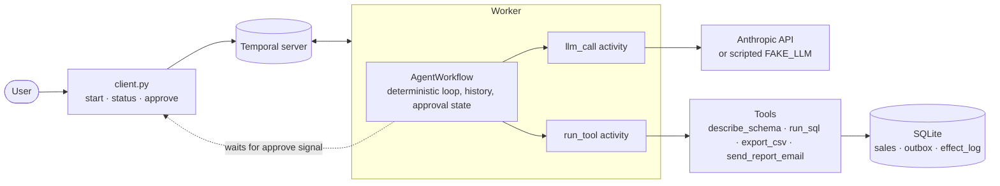

# Durable LLM Agent on Temporal

A tool-using SQL analytics agent whose loop runs as a **Temporal workflow**. Kill the worker mid-run and the task resumes where it stopped, with no duplicated emails or files.


## The problem

A plain agent loop lives in process memory. A deploy, an out-of-memory kill or a crash loses the conversation, and a naive retry sends the report email twice. Long human-approval waits (hours or days) are worse. Temporal records every step in a durable history and replays it after a failure, so the agent continues from its last recorded step.

## Architecture



The agent answers natural-language analytics questions over a synthetic `sales` SQLite table. Tools: `describe_schema`, `run_sql` (single read-only `SELECT`), `export_csv`, and `send_report_email` (risky, needs human approval). A picture version is in `docs/architecture.svg`.

## Workflow vs activity boundary

| | Workflow (`workflows.py`) | Activity (`activities.py`) |
|---|---|---|
| Holds | loop, message history, step counter, approval state | LLM call, SQL, file write, email |
| May do | decide, branch, wait on signals and timers | any I/O, any non-determinism |
| After a crash | **re-executed from the top**, fed recorded results | executed again only if it never recorded a result |
| Failure policy | n/a | retry policy and timeout per call |

### Determinism rules for workflow code

1. No network, file, database or LLM calls. Put them in activities.
2. No `datetime.now()`, `random` or `uuid4()`. Use `workflow.now()`, `workflow.random()`, `workflow.uuid4()`.
3. No threads; use the `asyncio` primitives Temporal provides (`wait_condition`, timers).
4. The same code must make the same decisions given the same history. Changing workflow logic for in-flight runs needs versioning (`workflow.patched`).
5. Keep history bounded: `continue_as_new` after `CAN_AFTER` steps.

### Why there are no duplicates

Activities are **at-least-once**: if the worker dies after the effect but before the result is recorded, Temporal retries. So tools must be idempotent:

- Every tool call gets `key = workflow_id:step:index`. The key comes from the replayed workflow, so a retry carries the same key.
- `send_report_email`: `INSERT OR IGNORE` on the outbox primary key. A second attempt is a no-op and is logged in `effect_log` with `applied=0`.
- `export_csv`: the output path is derived from the key, so a rerun overwrites the same file.

Limit: this works because the simulated provider accepts an idempotency key. A real email API needs the same feature, or a lookup before sending.

## Human approval

Risky tools block on `workflow.wait_condition` until the `approve(key, ok)` signal arrives (timeout 2 days, after which the agent is told "approval timed out"). Waiting costs nothing and survives worker restarts.

```bash
python -m durable_agent.client status demo          # {'step': 4, 'pending_key': 'demo:4:0'}
python -m durable_agent.client approve demo demo:4:0 [--deny]
```

## Quickstart

```bash
cp .env.example .env && make install
docker compose up -d      # Temporal server and UI (localhost:8080)
make seed worker          # terminal 2
make chaos                # kills the worker 3 times, asserts 0 duplicates
make test                 # unit and workflow tests, no Docker needed
```

`FAKE_LLM=1` scripts the model so chaos runs are free and reproducible. Without it, `llm_call` uses the Anthropic API (set `ANTHROPIC_API_KEY`).

## Results

One observed chaos run, with the scripted model and a local Temporal dev server (`python tests/chaos.py --kills 3 --seed 42`):

```
killed worker #1
killed worker #2
killed worker #3
result='done: report exported and emailed' kills=3 emails_sent=1 send_attempts=1
PASS: completed, 0 duplicate side effects
```

This is a single run. There are **no latency, throughput or cost figures** yet, no comparison with a non-durable loop, and no run against a live model.

## Status and findings

Checked on 2026-10-30:

- **Tests:** 7 pass: 4 idempotency tests on the tools, and 3 workflow tests on Temporal's time-skipping test server (the email is sent once after approval, a denied email is not sent, and an email activity that fails once after sending is retried without a duplicate). `ruff check` passes.
- **Chaos test:** one run passed, as shown above.
- **Fixed while preparing this repository:** the README claimed a 20-run evaluation with a comparison against a non-durable loop, from a results file of imaginary data. It was removed, together with a `make eval` target that pointed at a missing runner. Lint findings were fixed and `__init__.py` was added to the package.
- **Not built:** a non-durable baseline loop, an evaluation runner, history summarisation, a child-workflow sub-agent, a demo recording (a storyboard is in `docs/demo.md`) and a worker service in `docker-compose.yml`.
- **Note:** `CAN_AFTER` is 40 steps while `MAX_STEPS` is 12, so continue-as-new is never reached with the current settings.

## References

Inspiration only, not checked for licence or activity: temporal-community/temporal-ai-agent, temporal-agent-harness, tutorial-temporal-ai-agent, piotrwachowski/durable-agents.

## License

[MIT](LICENSE)
